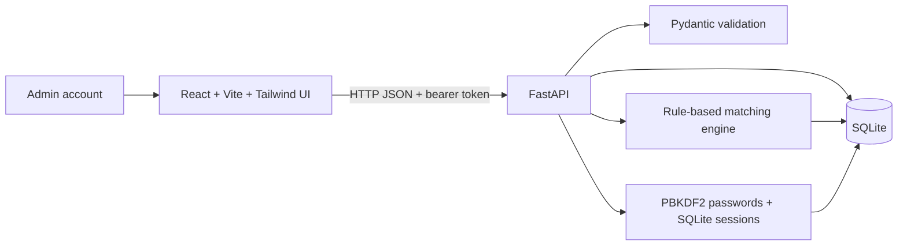

# Technical approach

## Architecture

## Stack and rationale

- **React + Vite + Tailwind CSS:** a small, fast single-page UI with a straightforward local development server. A small custom stylesheet supplements Tailwind utility styling for the prototype's layout.
- **FastAPI + Pydantic:** concise JSON APIs, input validation, and generated OpenAPI/Swagger documentation at `/docs`.
- **SQLite with Python's standard `sqlite3`:** zero external database setup and easy local persistence.
- **Python `difflib`:** built-in approximate text matching avoids adding a machine-learning dependency or network service.

## Data model

SQLite tables implement the core workflow:

- `items`: lost/found type, descriptive attributes, event date/location, private contact email, status, creator, and creation time.
- `matches`: reserved for persisted pair results; matching is computed on demand so newly added reports can immediately match earlier reports.
- `claims`: found item, claimant email, private proof, pending/approved/rejected status, admin notes, and creation time.
- `users`: account name, unique email, salted PBKDF2 password hash, role, and creation time.
- `sessions`: bearer token, owning user, and seven-day expiration.

Each request that needs an identity uses an `Authorization: Bearer <token>` header. Registration always creates a student; admin privileges come only from the seeded admin account. Sessions expire after seven days and can be revoked by logging out.

## Matching algorithm

Only opposite-type reports with an exact case-insensitive category match are considered; category mismatch is a hard exclusion. The configurable weights in `backend/config.py` sum to 100:

| Signal | Weight | Scoring |
|---|---:|---|
| Title + description text | 35 | Maximum of normalized `difflib.SequenceMatcher` ratio and token Jaccard overlap |
| Color | 15 | Exact case-insensitive match |
| Brand | 10 | Exact case-insensitive match |
| Location | 20 | Exact location: 1.0; shared first location token: 0.65; any shared token: 0.45 |
| Date plausibility | 20 | Found date must be on/after lost date and within 30 days; score decays linearly to zero |

The final integer score is `round(sum(weight × signal score))`; only positive scores are returned, sorted highest-first, capped at five. The explanation names the category match and any text, color, brand, location, and date signals that contributed.

This heuristic is explainable but not semantic: category labels must agree, text may miss synonyms, and location token overlap can be imprecise. Scores are suggestions, not proof of ownership.

## Claims and privacy

Public item endpoints omit contact email and creator identity. Contact details are available only from the admin-only `GET /admin/items/{id}` endpoint and in the admin view of claims. `POST /claims` accepts a proof description but only the admin view of `GET /claims` includes proof and claimant email. A claimant can see their own claim's status, admin notes, and collection location, not the proof field or finder email. Claiming is blocked for the finder and duplicate pending claims. Approving a claim changes the item from `open` to `claimed` and rejects any other pending claims for that item. The claimant can confirm collection to change it to `returned`; rejected claims leave the item open. Owners can mark their own open lost reports recovered or delete their own open reports.

The local demo uses seeded credentials documented in the README. A production deployment should still consider campus SSO, CSRF protections where applicable, rate limiting, secure secret management, and careful handling/retention of contact and claim data.

The Render Blueprint sets `PUBLIC_DEMO_READ_ONLY=true`. In this mode, the API rejects report/claim/item writes, blocks claim records and admin endpoints, and the frontend displays a read-only banner while hiding write controls. Public read-only access therefore does not depend on the UI to enforce the boundary.

## Trade-offs and next steps

Under the hackathon time limit, image upload, image similarity, outbound email notifications, and map view are omitted. The priority is a demonstrable local workflow and transparent matching. The next steps would be campus SSO, stronger claim/audit workflows, image storage and visual similarity, geocoded campus locations, and deployment monitoring/backups.
