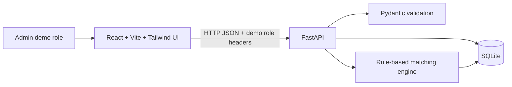

# Technical approach

## Architecture

## Stack and rationale

- **React + Vite + Tailwind CSS:** a small, fast single-page UI with a straightforward local development server. A small custom stylesheet supplements Tailwind utility styling for the prototype's layout.
- **FastAPI + Pydantic:** concise JSON APIs, input validation, and generated OpenAPI/Swagger documentation at `/docs`.
- **SQLite with Python's standard `sqlite3`:** zero external database setup and easy local persistence.
- **Python `difflib`:** built-in approximate text matching avoids adding a machine-learning dependency or network service.

## Data model

Three SQLite tables implement the core workflow:

- `items`: lost/found type, descriptive attributes, event date/location, private contact email, status, creator, and creation time.
- `matches`: reserved for persisted pair results; matching is computed on demand so newly added reports can immediately match earlier reports.
- `claims`: found item, claimant email, private proof, pending/approved/rejected status, admin notes, and creation time.

The prototype uses the claimant email as the demo identity. Role selection is passed in request headers; this is intentionally a demo-only substitute for campus authentication.

## Matching algorithm

Only opposite-type reports with an exact case-insensitive category match are considered; category mismatch is a hard exclusion. The configurable weights in `backend/config.py` sum to 100:

| Signal | Weight | Scoring |
|---|---:|---|
| Title + description text | 35 | Maximum of normalized `difflib.SequenceMatcher` ratio and token Jaccard overlap |
| Color | 15 | Exact case-insensitive match |
| Brand | 10 | Exact case-insensitive match |
| Location | 20 | Exact location: 1.0; shared first location token: 0.65; any shared token: 0.45 |
| Date plausibility | 20 | Found date must be on/after lost date and within 30 days; score decays linearly to zero |

The final integer score is `round(sum(weight × signal score))`; only positive scores are returned, sorted highest-first, capped at five. The explanation names the category match and any text, color, brand, location, and date signals that contributed.

This heuristic is explainable but not semantic: category labels must agree, text may miss synonyms, and location token overlap can be imprecise. Scores are suggestions, not proof of ownership.

## Claims and privacy

Public item endpoints omit contact email and creator identity. Contact details are available only from the admin-only `GET /admin/items/{id}` endpoint and in the admin view of claims. `POST /claims` accepts a proof description but only the admin view of `GET /claims` includes proof and claimant email. A claimant can see their own claim's status and admin notes, not the proof field or report contact. An admin approval changes the item from `open` to `claimed`; a separate admin return action changes it to `returned`. Rejected claims leave the item open.

There are no passwords or real identity checks; the browser's role selector sets demo headers. A deployed app must replace this with campus SSO, server-verified roles, CSRF protections, rate limiting, and secure handling/retention of contact and claim data.

The Render Blueprint sets `PUBLIC_DEMO_READ_ONLY=true`. In this mode, the API rejects all report/claim writes, blocks claim records and admin endpoints, and the frontend hides report, claim, and admin controls. Public read-only access therefore does not depend on the UI to enforce the boundary.

## Trade-offs and next steps

Under the hackathon time limit, image upload, image similarity, email notifications, real authentication, and map view are omitted. The priority is a demonstrable local workflow and transparent matching. The next steps would be campus SSO, stronger claim/audit workflows, image storage and visual similarity, email/in-app notifications, geocoded campus locations, and deployment monitoring/backups.
